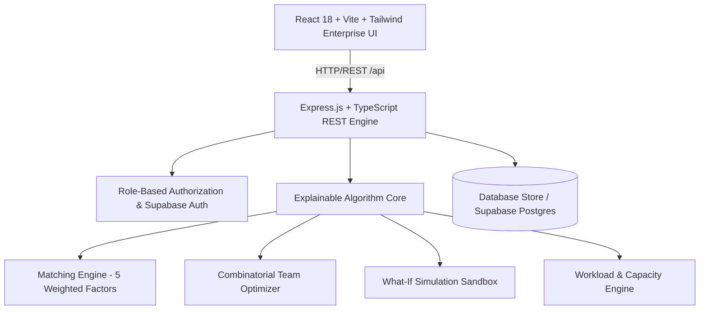

# TeamPulse Intelligence — System Architecture

## 1. High-Level Overview

**TeamPulse Intelligence** is an enterprise-grade AI-powered workforce planning, intelligent team formation, and workload optimization platform.

It addresses three fundamental enterprise challenges:
1. **Explainable Team Formation**: Eliminating subjective bias and guessing through deterministic multi-factor personnel matching.
2. **Capacity-Aware Workload Allocation**: Tracking real temporal capacity to prevent employee burnout (>100% capacity).
3. **Interactive What-If Workforce Simulation**: Empowering managers to test proposed roster alterations, allocation percentages, and competency swaps before committing approved assignments.

---

## 2. Component Architecture

### Frontend Layer
- **Framework**: React 18, Vite, TypeScript
- **Styling & Design System**: Tailwind CSS v3 with enterprise slate/navy palette, custom scrollbars, and accessible WCAG 2.2 AA contrast ratios.
- **Routing**: React Router v7 with role-aware layouts (`AppLayout`, `Sidebar`, `Header`).
- **Data Visualization**: Recharts for smooth area progress overview curves and workforce allocation donuts.
- **Iconography**: Lucide React.
- **State Management**: TanStack Query and React Context (`AuthContext` with instant dynamic role switching: EMPLOYER / ADMIN / EMPLOYEE).

### Backend Layer
- **Runtime**: Node.js v22+, Express 4/5, TypeScript.
- **Security**: Helmet, CORS with strict origin allowances, parameterized database queries.
- **Validation**: Strict Zod schemas on all incoming request bodies.
- **Error Handling**: RFC-7807 compliant structured JSON responses with zero raw server stack leakages.
- **Logging**: Morgan HTTP logger and structured decision audit logging.

### Algorithm Engine
1. **Explainable Matching Engine**:
   - Skill Match (40%): Evaluates proficiency level vs minimum requirement, criticality, and verified vs self-reported credentials.
   - Experience Score (20%): Normalized years in domain vs expected seniority.
   - Availability Score (20%): Available (100%), In a Meeting (80%), Busy (40%), On Leave (0%).
   - Workload Suitability (10%): Headroom analysis with burnout penalties.
   - Domain Affinity (10%): Departmental and tech stack alignment.
2. **Composition Optimizer**:
   - Multi-objective combinatorial selection.
   - Guarantees critical skill requirements are satisfied before general slot-filling.
   - Generates trade-off summaries and capacity alerts.
3. **Simulation Engine**:
   - Sandbox state evaluator allowing non-committed personnel replacements, removals, and allocation adjustments.
   - Side-by-side delta calculations against currently approved assignments.
4. **Workload & Capacity Calculator**:
   - Granular weekly capacity calculations: $\text{Utilization \%} = \frac{\text{Assigned Hours}}{\text{Weekly Capacity Hours}} \times 100$.

### Persistence & Database Layer
- **Supabase Hosted PostgreSQL**: 16 normalized tables with foreign keys, checks, indexes, and Row Level Security (RLS) policies.
- **Seed & In-Memory Fallback**: Zero-dependency local demonstration mode preloaded with 152 employees, active projects, competencies, training courses, and audit events.
